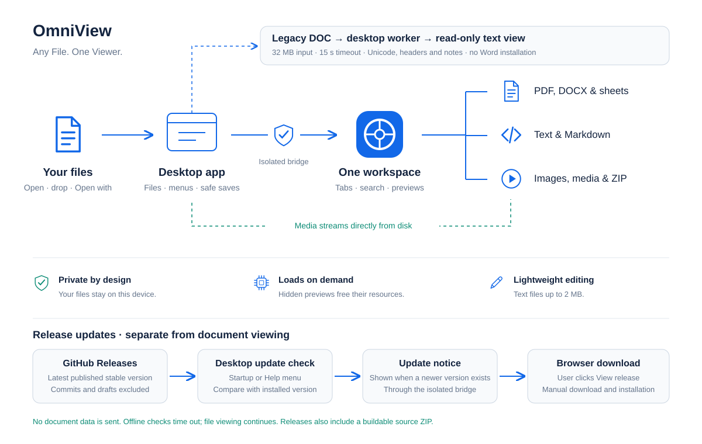

<p align="center"></p>

View local files in one tabbed desktop app on Windows, Linux and macOS. Documents stay on your computer; viewing works offline.

## Download

**Version 1.12.0 · [All downloads and checksums](https://github.com/4Raisan/OmniView/releases/latest)**

- **Windows x64:** [Installer](https://github.com/4Raisan/OmniView/releases/download/v1.12.0/OmniView-Setup-1.12.0-x64.exe) or [portable](https://github.com/4Raisan/OmniView/releases/download/v1.12.0/OmniView-Portable-1.12.0-x64.exe).
- **Linux x64:** [AppImage](https://github.com/4Raisan/OmniView/releases/download/v1.12.0/OmniView-1.12.0-linux-x86_64.AppImage) or [Debian package](https://github.com/4Raisan/OmniView/releases/download/v1.12.0/OmniView-1.12.0-linux-amd64.deb).
- **macOS:** [Apple Silicon](https://github.com/4Raisan/OmniView/releases/download/v1.12.0/OmniView-1.12.0-mac-arm64.dmg) or [Intel](https://github.com/4Raisan/OmniView/releases/download/v1.12.0/OmniView-1.12.0-mac-x64.dmg).

**Source:** [Complete project ZIP](https://github.com/4Raisan/OmniView/releases/download/v1.12.0/OmniView-1.12.0-source.zip) · [SHA256 checksums](https://github.com/4Raisan/OmniView/releases/download/v1.12.0/SHA256SUMS.txt).

Choose PDF defaults through your OS's **Open with** settings. Windows builds are unsigned; Mac builds use ad-hoc signing and are not notarized. See [installation notes](docs/DEVELOPMENT.md).

## What it does

- Open PDFs, Word documents, slides, spreadsheets, images, media, and ZIP archives locally.
- Search and copy PDF text, including in password-protected PDFs after unlocking them.
- Edit UTF-8 text and Markdown up to 2 MB with a live preview and crash recovery.
- Switch spreadsheet sheets, filter rows, and export a sheet to CSV.
- Browse with keyboard-friendly tabs, drag and drop, themes, and recent files.
- Search large text files, adjust media playback speed, and filter or extract ZIP entries.

See the [editing guide](docs/EDITING.md) and [changelog](CHANGELOG.md) for more detail.

## How it works



## Build from source

Use Node.js 22.12 or newer.

Releases from 1.9.0 include **OmniView-VERSION-source.zip**, a complete source bundle with the pinned SheetJS archive, build configuration and documentation. Extract it, then run the commands below. Installed dependencies and Electron are downloaded by `npm ci`; the ZIP is not a preinstalled application. The app downloads are separate release assets, so large binaries do not need to be committed to Git.

Update checks contact GitHub Releases at startup and when requested; they send no document contents, filenames or local paths. Checks time out if offline and do not interrupt viewing. A notice opens the release page for a manual download; it does not install updates. Only published stable releases trigger notices, not commits or drafts. Versions before 1.9.0 need one manual upgrade to gain update notices.

```sh
npm ci
npm run build
npm start
```

`npm run package` builds Windows; `npm run package:linux` builds Linux; `npm run package:mac` builds on macOS.

[Detailed guide, installation and troubleshooting](docs/DEVELOPMENT.md) · [Editing](docs/EDITING.md) · [Measured performance](docs/PERFORMANCE.md) · [Changelog](CHANGELOG.md)

## Support

[Star OmniView](https://github.com/4Raisan/OmniView) if it helps you. [Share ideas and feedback](https://github.com/4Raisan/OmniView/discussions/5), or [report a problem](https://github.com/4Raisan/OmniView/issues). See [CONTRIBUTING.md](CONTRIBUTING.md) to send a change, and [SECURITY.md](SECURITY.md) to report a vulnerability privately — please do not open a public issue for one.

## Code signing policy

Windows builds are currently unsigned; signing-provider enrollment is being prepared. See the [code signing policy](docs/CODE_SIGNING.md) and [privacy policy](docs/PRIVACY.md). Signing status will be changed only after verified signed downloads are available.

## License

[MIT](LICENSE) · Copyright © 2026 4Raisan. Third-party dependencies retain their own licenses.
