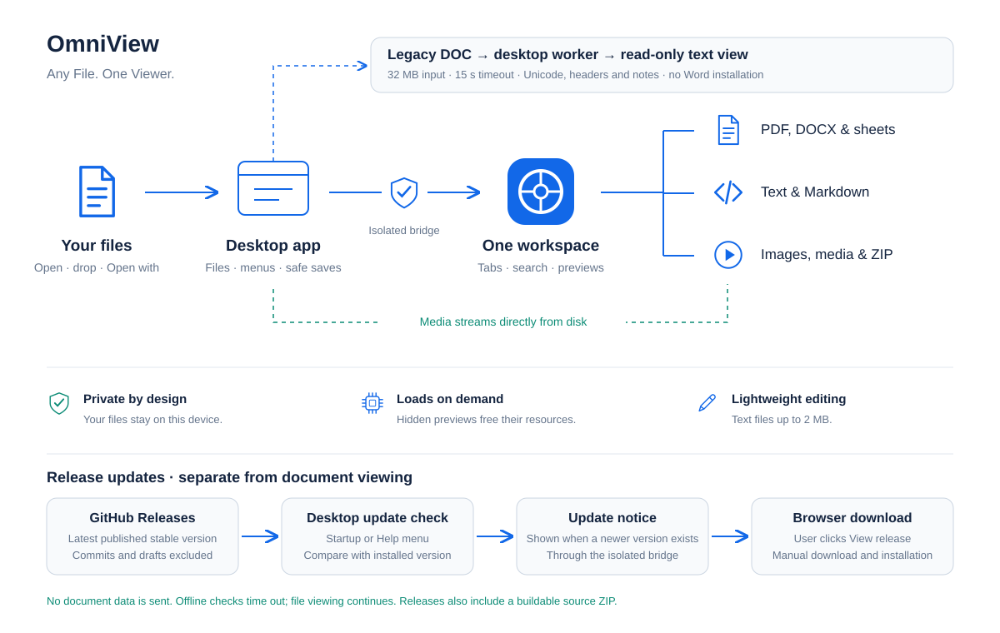

<p align="center"></p>

A Windows desktop app for viewing local files in one tabbed workspace. Documents stay on your computer; viewing works offline.

## Download

**Windows 64-bit · Version 1.7.0**

- [Installer (88.4 MB)](https://github.com/4Raisan/OmniView/releases/download/v1.7.0/OmniView-Setup-1.7.0-x64.exe) — shortcuts and PDF **Open with** support.
- [Portable (88.2 MB)](https://github.com/4Raisan/OmniView/releases/download/v1.7.0/OmniView-Portable-1.7.0-x64.exe) — run without installing.

To use OmniView for PDF double-clicks, choose it in Windows **Open with → Always**. Builds are unsigned, so Windows may show a publisher warning.

## What it does

- View PDFs, DOCX, spreadsheets, Markdown, text/code, images, audio/video and ZIP archives.
- Use compact tabs, drag and drop, search, six dark themes, adjustable text size and a resizable sidebar.
- Reopen your last 25 files from disk.
- Edit UTF-8 text and Markdown up to **2 MB**, with safe saves and live Markdown split preview.
- Scroll PDF pages continuously and stream native media from disk.

Media playback depends on codec support. DOC/RTF need conversion to DOCX; spreadsheet formulas display saved values.

**Shortcuts:** Ctrl+O open · Ctrl+W close tab · Ctrl+B sidebar · Ctrl+P print · F11 fullscreen.

## How it works



## Build from source

Use Windows and Node.js 22.12 or newer.

```sh
npm ci
npm run build
npm start
```

`npm run package` builds the installer; `npm run package:portable` builds the portable app.

[Detailed guide](docs/DEVELOPMENT.md) · [Editing](docs/EDITING.md) · [Measured performance](docs/PERFORMANCE.md)

## Support

[Star OmniView](https://github.com/4Raisan/OmniView) if it helps you. [Share ideas and feedback](https://github.com/4Raisan/OmniView/discussions/5), or [report a problem](https://github.com/4Raisan/OmniView/issues).
